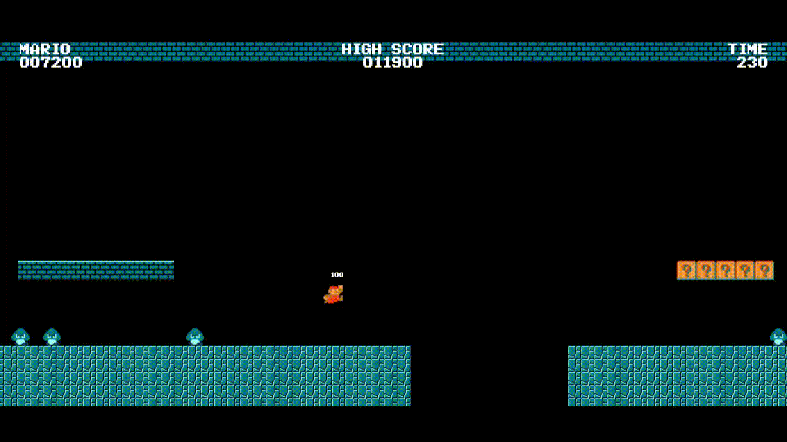
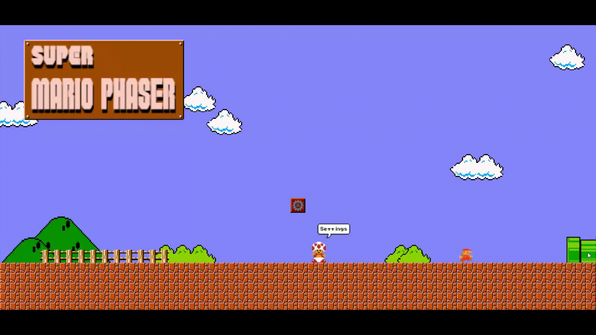
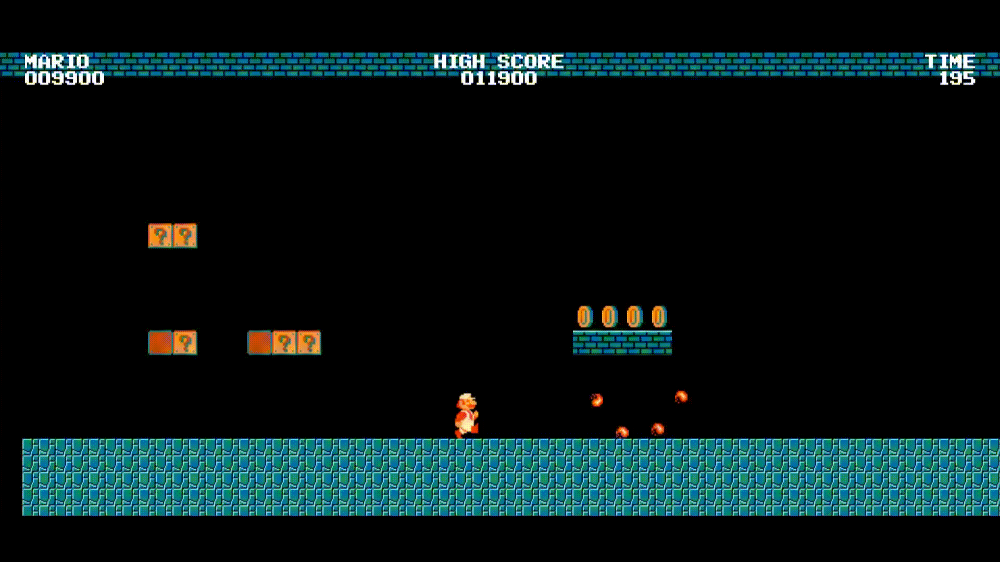
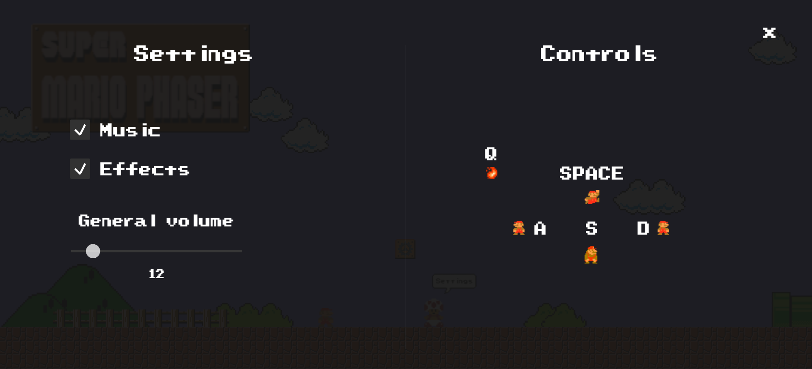

# **Super Mario Phaser**

Super Mario Phaser is a recreation of the classic Super Mario Bros game using the Phaser framework. This project aims to bring the nostalgic experience of playing the iconic platformer to modern web browsers. One exciting feature of this game is the random level generation, which ensures that each playthrough offers a unique and challenging experience.


## **Table of Contents**

- [Demo](#Demo)
- [Controls](#Controls)
- [Contributing](#Contributing)
- [License](#License)

### Demo

A live demo of the game can be accessed at [https://decapapi.github.io/Super-Mario-Phaser/](https://decapapi.github.io/Super-Mario-Phaser/).

Some screenshots of the game:









### Controls

Controls are fully customizable, however default controls are:

**Jump:** SPACE

**Move Left:** A

**Move Right:** D

**Crouch:** S

**Fire:** Q

To start the level, hold **D** (or the on-screen ▶ button) until the character
walks into the green pipe at the right edge of the start screen. You can also
press **SPACE** (the on-screen **A** button) or tap the on-screen hint to start
immediately.

### Running locally

Browsers block `XMLHttpRequest` on `file://`, so the game must be served over HTTP.
From the project root run:

```bash
python3 -m http.server 8000
```

Then open <http://localhost:8000/>. Phaser is bundled in
`javascript/lib/phaser.min.js`, so the game also works without internet access
(only the optional screenshot button loads `html2canvas` from a CDN).

On touch devices a virtual gamepad is displayed: `◀ ▶` move, `▼` crouch,
`A` jump, `B` fire and `SELECT` opens the in-game settings menu.

### Custom sprites

The player uses three high-resolution spritesheets (6× the original 18×16 / 18×32
pixel art, so the character stays sharp when scaled up):

| File | Frames | Frame size | Sheet size |
|---|---|---|---|
| `assets/entities/mario.png` | 6 (idle / run×3 / hurt / jump) | 108×96 | 648×96 |
| `assets/entities/mario-grown.png` | 6 (idle / run×3 / crouch / jump) | 108×192 | 648×192 |
| `assets/entities/mario-fire.png` | 7 (idle / run×3 / crouch / jump / throw) | 108×192 | 756×192 |

The artwork must match **these exact spritesheet sizes**. Dropping the raw AI
picture (a 4128×1024 or 5376×796 JPEG) into `assets/entities/` — even renamed to
`.png` — will not work, because Phaser slices it with `frameWidth/frameHeight`.

Put the raw artwork in `assets/entities/source/` and regenerate the sheets:

```bash
pip install pillow
python3 tools/generate_pig_sprites.py
```

The resolution multiplier lives in two places that must stay in sync:
`SCALE` in `tools/generate_pig_sprites.py` and `playerSpriteScale` in
`javascript/game.js`. The on-screen size is controlled by
`playerSizeMultiplier` in `javascript/game.js` (currently `1.35` = 35% bigger
than the original 18×16 / 18×32 sizes).

If you replace the artwork with a different layout, update the pose `x` ranges in
`SRC` inside `tools/generate_pig_sprites.py` (the tool prints the generated sheet
sizes so you can verify the result).

### Custom scenery

The level-end shop and the start-screen sign also use high-resolution artwork:

| File | Source | Output size |
|---|---|---|
| `assets/scenery/castle.png` | `assets/scenery/source/castle.jpg` (2400×1792) | 708×640 |
| `assets/scenery/sign.png` | `assets/scenery/source/sign.jpg` (1024×512) | 1024×512 |

Regenerate both PNGs after changing the source artwork:

```bash
python3 tools/generate_scenery.py
```

The tool crops the main "Naughty Nuri's" building out of the 2400×1792 image
(dropping the neighbouring building, the blurred photo and the lamp/sign mounted
on the right wall) and scales it to 640 px tall. The top of the source image cuts
through the upper-floor arches, so the crop starts just below the upper balcony
to give the sprite a clean top edge. The on-screen size is controlled by
`castleScale` / `signScale` in `javascript/game.js`; they reproduce the original
80×80 castle and 176×88 sign footprints, so update them if the output sizes
change.

Note: the original uploads were JPEG data despite their `.png` extension; the
copies in `assets/scenery/source/` use the `.jpg` extension so the actual format
is obvious. Keep the originals there and let the tool write the game-ready PNGs.

### Contributing

Contributions are welcome! If you find any issues or have suggestions for improvements, please open an issue or submit a pull request. Make sure to adhere to the existing code style and follow the established guidelines.
